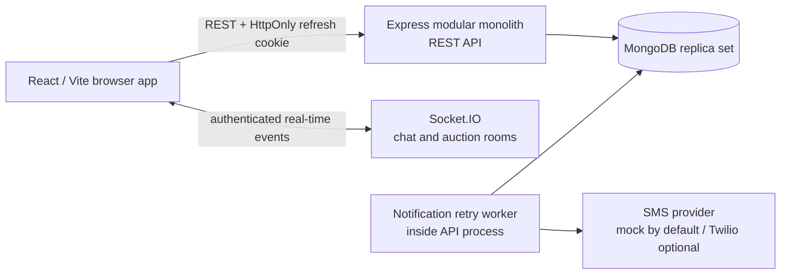
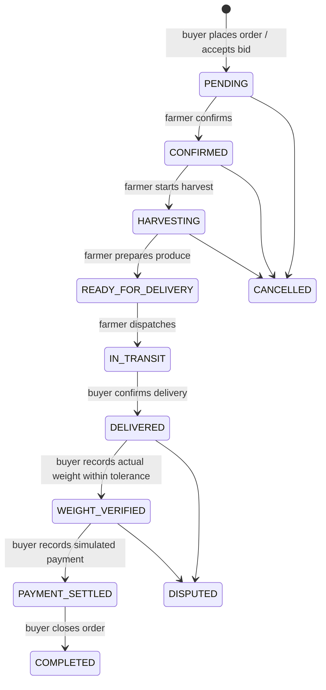
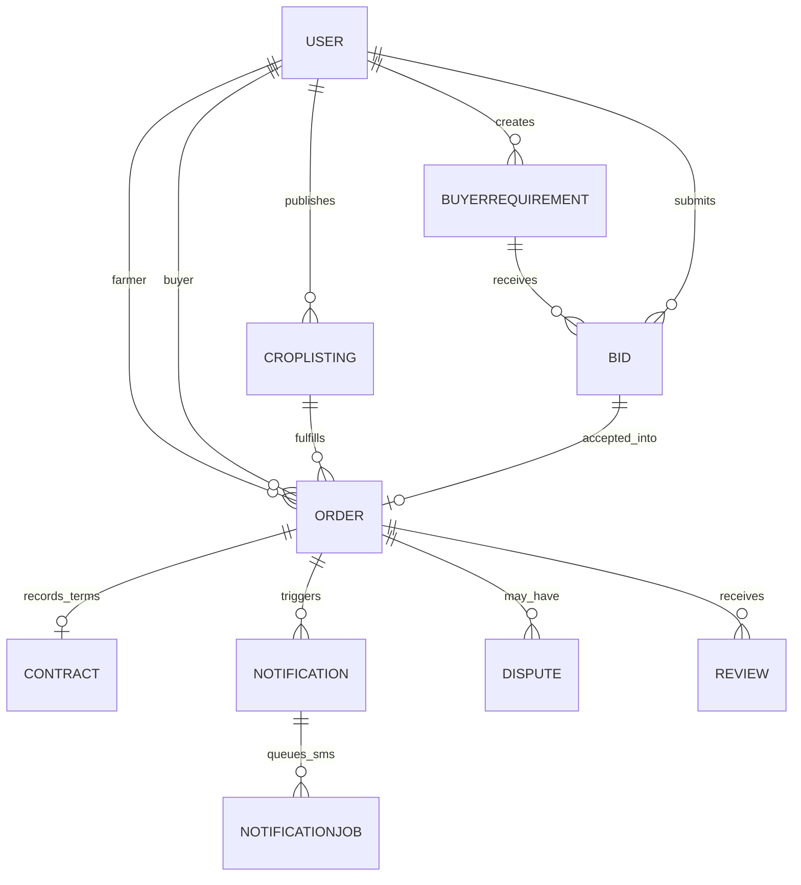

# Farm-E architecture and workflows

## Deployment view

The worker currently runs in the backend process. It claims persisted notification jobs, retries temporary SMS failures with backoff, and records `QUEUED`, `SENT`, `MOCKED`, `RETRY`, or `FAILED` state. Keep it in-process for the prototype; a separate worker deployment can be a future scaling step.

## Backend modules

| Module | Responsibility |
| --- | --- |
| Authentication and farms | Account sessions, roles, farmer profile and farm details |
| Marketplace | Crop listings, buyer requirements, bids and auction access |
| Orders and contracts | Stock reservation, bid acceptance, order transitions, catch-weight verification, private order evidence and contract snapshots |
| Communications | Conversations, messages, notification preferences, in-app notifications, SMS outbox and reviews/disputes |
| Admin and analytics | Management views, audits and aggregate reporting |

These are code-level boundaries inside one deployable API. The project does not currently need Kafka or independent microservices.

## Order lifecycle

The payment step is a demonstration state transition. It does not make a real payment.

## Data relationships

## Design decisions and limitations

- Transactions keep stock reservation, bid acceptance, order/contract creation, and the notification outbox consistent. MongoDB multi-document transactions require a replica set or sharded deployment; a standalone MongoDB server is not sufficient.
- SMS uses a MongoDB-backed outbox for durable retries. The default mock mode records the workflow without sending a phone message.
- Buyer requirement suggestions reuse an explainable compatibility score across crop, quantity, price, quality, harvest timing, and approximate farm distance. Farm coordinates and evidence files remain protected by participant access checks.
- Trace passports provide a SHA-256 fingerprint of displayed record fields. This is not blockchain storage or an independent integrity attestation.
- Kafka, payment gateway integration, and microservice deployment are future options only if project requirements or measured workload justify them.
